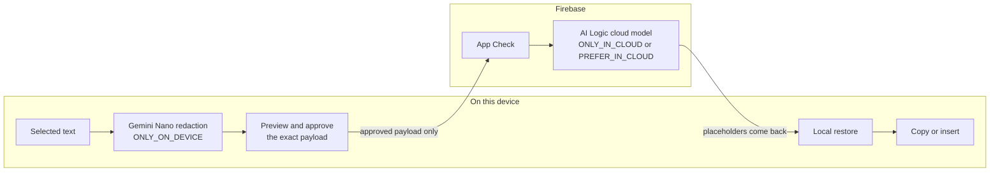

# Wysend

**The cloud never sees your secrets. You see exactly what it sees.**

Wysend is pronounced WHY-send. The name is short for “what you see is what you send.”

## For judges

You can judge the privacy path without a Firebase login. Detection, the payload preview, and local restore all run from the unpacked extension.

1. `npm install`
2. `npm test` and `npm run eval` (50 synthetic samples, precision 100%, recall 100% on the labeled set)
3. `npm run build`
4. Open `chrome://extensions`, turn on Developer mode, and choose **Load unpacked**. Select the `dist` folder.
5. `npm run demo`, then select the complaint on that page. Right-click and choose **Wysend: finish this privately**, or open the side panel and click **Use selection**.
6. Read the outbound payload. It should contain placeholders such as `[PERSON_1]`, not the phone number or the key. Approve it.
7. **Run task** needs the Firebase project below and an App Check debug token entered in the side panel. Without that token, Firebase AI Logic returns `401 Firebase App Check token is invalid`, which is the enforced check working.

Chrome 139 or newer is required for Gemini Nano. Until Nano is downloaded, the rules still redact, and the raw text is still not sent to the cloud.

## What Wysend is

Support leads, founders, and engineers ask a model to finish real work: reply to a complaint, summarize a contract clause, explain a log. The answer is the useful part. The source text is the risky part. It holds names, phone numbers, addresses, account numbers, cards, national IDs, and API keys.

Wysend is a Manifest V3 Chrome extension. You select that text and pick a task: draft a reply, summarize, analyze, or explain.

1. Deterministic detectors run immediately. Gemini Nano, through Firebase AI Logic with `ONLY_ON_DEVICE`, can take a second pass. Sensitive spans become stable placeholders. The mapping stays in `chrome.storage.session`.
2. The side panel shows the exact UTF-8 payload, its byte length, and a SHA-256. You approve that string.
3. Firebase AI Logic runs the task on the approved string only.
4. Placeholders in the answer are restored on this device. You read the result, then copy or insert it.

Paste protection is a secondary control. Per site, Wysend can auto-redact, warn, or block. The product is the task, not the paste.

## Architecture



Raw text stops at the on-device step. The cloud call is the string you approved, and App Check is enforced on Firebase AI Logic before that call is accepted. Restoration never happens on the server.

## Install the unpacked extension

```bash
npm install
npm run build
```

1. Open `chrome://extensions`.
2. Turn on **Developer mode**.
3. Click **Load unpacked**.
4. Select the `dist` folder from this repo.

The sample page is `npm run demo`. The side panel layout, without Chrome APIs, is `npm run dev`.

## Chrome and Gemini Nano

On-device inference needs desktop Chrome 139 or newer. Check `chrome://settings/help`.

1. Open `chrome://flags/#prompt-api-for-gemini-nano-multimodal-input` and set it to **Enabled**.
2. In `chrome://flags`, search for **Gemma 4 for Built-in AI** and enable that too.
3. Restart Chrome.
4. In the Wysend side panel, click **Prepare on-device model** once. That click is the user gesture Firebase AI Logic requires before `initializeDeviceModel()`. The download can take several minutes. The panel shows the progress.

Optional check in DevTools: `await LanguageModel.availability()`, then `await LanguageModel.create()`.

If Nano is unavailable, Wysend keeps the rules result. It does not upload the raw text to cover for a missing local model.

## App Check debug token

Firebase AI Logic on this project has App Check enforced with reCAPTCHA Enterprise. The public site key is the default for `VITE_FIREBASE_RECAPTCHA_ENTERPRISE_SITE_KEY`. A Chrome extension page cannot load the remote reCAPTCHA script, so the extension uses a debug token that is already registered for the app. The token is not in this repository.

1. Load the extension and open the Wysend side panel.
2. Open the **Firebase** section.
3. Paste the registered debug token into **App Check debug token**.
4. Click **Save token and reload**.

The value stays in `chrome.storage.local` on that profile. Do not put it in a committed file, and do not publish a `dist` that was built with the token baked in.

For the Node check, put `VITE_FIREBASE_APPCHECK_DEBUG_TOKEN` in `.env.local` (gitignored) and run `npm run smoke:cloud`. That script sends three redacted samples through `ONLY_IN_CLOUD` and exits nonzero if an original secret is still in the payload.

## Hybrid inference

Every model call goes through the Firebase AI Logic Web SDK (`firebase/ai`) and the Gemini Developer API. There is no other LLM client.

| Step | Mode | Why |
|---|---|---|
| Redact the raw text | `ONLY_ON_DEVICE` | Gemini Nano, or an error. `PREFER_ON_DEVICE` would upload the prompt when Nano is missing, so Wysend does not use it here. A response that reports `inferenceSource: in_cloud` is discarded. |
| Run the task | `ONLY_IN_CLOUD` or `PREFER_IN_CLOUD` | Only the approved, already redacted payload is sent. Prefer-cloud may fall back on-device if the network is down. That fallback is safe because the text is already redacted. Cloud-only fails closed instead. |

The task badge is the SDK field `result.response.inferenceSource`: `on_device` or `in_cloud`.

The cloud model is `gemini-3.5-flash-lite`. Remote Config can change the task prompts and that model name. It cannot turn off the payload guard or move raw text onto a cloud mode.

The public web config is the default in [`src/firebaseConfig.ts`](src/firebaseConfig.ts). Counts and team policies, if you turn them on, go to Cloud Firestore as numbers and policy enums only. Raw text is not a field. See [`firestore.rules`](firestore.rules).

## Evaluation

`npm run eval` scores the deterministic detector on [`src/lib/redaction/dataset.ts`](src/lib/redaction/dataset.ts): 50 synthetic samples and 44 labeled entities, in English, Spanish, French, German, Portuguese, and Japanese. A match requires the same type and the same canonical value. Matching is one-to-one. The set includes negatives (invoice numbers, versions, prices, times) that must not match.

| | |
|---|---:|
| Samples | 50 |
| Labeled entities | 44 |
| Precision | 100% (44/44) |
| Recall | 100% (44/44) |

| Type | Precision | Recall | TP | FP | FN |
|---|---:|---:|---:|---:|---:|
| PERSON | 100% | 100% | 12 | 0 | 0 |
| PHONE | 100% | 100% | 10 | 0 | 0 |
| EMAIL | 100% | 100% | 4 | 0 | 0 |
| ADDRESS | 100% | 100% | 6 | 0 | 0 |
| BANK | 100% | 100% | 3 | 0 | 0 |
| BVN | 100% | 100% | 1 | 0 | 0 |
| NIN | 100% | 100% | 1 | 0 | 0 |
| CARD | 100% | 100% | 1 | 0 | 0 |
| SSN | 100% | 100% | 1 | 0 | 0 |
| API_KEY | 100% | 100% | 3 | 0 | 0 |
| SECRET | 100% | 100% | 2 | 0 | 0 |

This is agreement with the labeled set. It is not a claim about every name in the wild. A name with no cue, such as “Ask Zubby,” is left for the on-device model and is not in the score.

## License

[Apache License 2.0](LICENSE).
